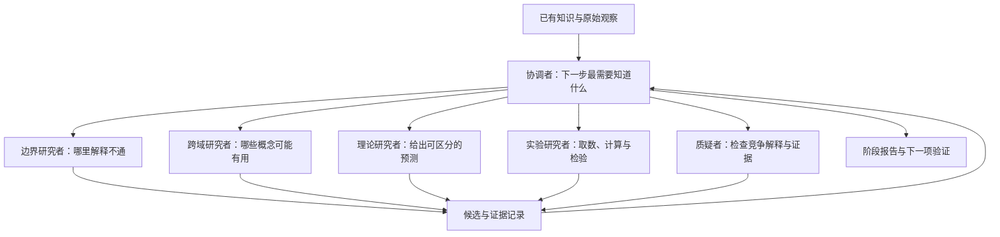

# 从解释缺口到新 idea

系统的研究状态由三部分组成：目前想解释的现象、仍然存活的竞争解释、能够改变判断的下一项证据。协调者决定下一项工作，角色使用真实工具完成工作，结果再次进入协调者的上下文。

## 研究者真正能改变什么

研究问题、变量定义、关系形式、数据来源、实验条件和解释范围都可以修改。程序没有给出正确答案、缺失变量列表或可选公式模板。研究者可用 Python 表达新状态，检索其他领域的关系，并主动寻找能够推翻自身解释的观察。

早期念头只需保存现象、可能的新区分和一个廉价检查。出现具体预测后再补齐证据账本。与已有工作重叠时，研究者应找清真正尚未解决的部分；结果不支持时，可以改变表示或研究问题。

## 实现

`discover.py` 的循环只维护状态、预算、允许的角色和文件路径。它不写科学公式，也不决定哪项假说成立。每轮下一项角色和任务来自协调者的 `result.json`。

`runtime.py` 用已有登录启动独立 GPT-6 Luna 调用。每次调用有单独工作目录和输入输出记录；各角色通过公开的研究文件合作，完整工具调用记录保存在事件日志中。角色输出回到协调者后，后者可以再次派发同一角色或换方向。

当前科学任务顺序执行，六种职责按需使用。早期选题和实现工作使用了三个并行 Luna 子任务；这与科学循环内的角色调度分别记录。

## 初版的能力范围

已经实现：公开资料检索、本地数值实验、基于结果的任务派发、逐次证据记录、失败保留与断点恢复。真实探索运行中的结果写入 `INITIAL_RESULTS.md`。

首版使用任务级独立上下文和共享文件，没有长期向量记忆，也没有把多角色结构本身宣称为优于单 agent。现阶段通过完整案例检验能否产出有用的新解释；持续有效后，再比较组织结构与资源效率。

## 如何判断一次探索带来了什么

提出候选、取得初步支持、复现结果和确认文献新颖性是不同状态。报告逐项说明证据；程序正常结束只代表执行完成。一个失败但使问题变得更清楚的实验会保留在记录中，以便后续研究者继续，而不被改写成成功。
