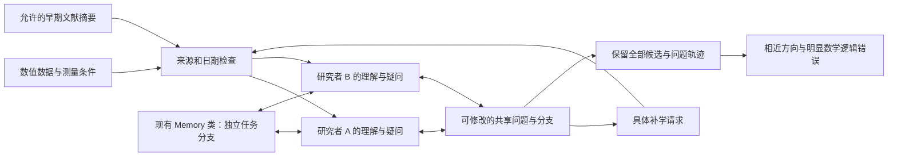

# 研究者协作提问入口

2026-11-05 统一修正已实现在 **`fish_inquiry.py`**：按任务日期联网补学、保留来源数据与测量背景、可组合计算与控制器能力交回、经来源审核的持续记忆及停滞处理。新运行请使用 [开放补学与探索 v2](OPEN_INQUIRY_V2_CN.md)。`fish_pilot.py` 和下文保留的封闭语料入口用于历史协议与结果复查。

## 历史封闭语料入口

这是新增入口，现有 `src/learning_memory.py`、`src/learning_lab.py`、原研究者笔记和历史运行均保留。运行前已为 312 个现有文件保存哈希，结束后复核。

## 连接现有结构

`run.py` 直接导入现有 `Memory` 类和笔记协议，不重新实现持续记忆。当前 v3 流程是“独立理解 → 相互回应 → 因交流补学 → 返回讨论 → 新会话接续 → 冻结候选 → 外部两项检查”。交流、补学、返回和接续后可按需进入内部证据核查与共同回应。两位研究者都提出自己的问题，也都能改变共享问题；第二位不被设定为反驳或辅助角色。



代码维护来源许可、实际输入快照、记忆版本、消息顺序、学习请求和共享对象版本；提示引导研究者提出预期、说明理由、回应对方和修订解释。不会把满足格式要求当成产生了新科学问题。

## 个人问题与共享问题协议 v2

已修复首轮中 `question_before` 归属含义不清的问题。新运行独立写入 `cases/<情境>/runs/<run-id>/`，不接续或改写旧试跑的输入、候选、检查、问题轨迹和代码快照。

`question_state.py` 单独记录个人问题与共享问题。每条记录包含控制器分配的 ID、归属、版本、提出者和来源阶段。每次交流、补学、返回及新会话接续都收到明确的 `self`、`peer_questions`、`shared_question`，而不是让模型重新描述“我之前问什么”。两人的初始回答也带研究者标签；独立初始学习仍不会读到对方的初始问题。

研究者分别提交 `personal_question_update` 和 `shared_question_update`。个人问题只允许本人基于准确版本保留或修订；共享问题的提案/修订不会自动改变任何人的个人问题。允许主动转向对方或共同问题，但必须说明原因，并可引用具体问题版本。共享提案不等于双方已经同意。

控制器在写入状态或长期笔记前拒绝错误归属、过期版本、保留但暗改内容、缺少原因，以及旧的含糊 `question_before/question_after` 字段。真实的修改前状态由代码从已存记录取得，原始回答和旧版本均保留。输入快照固定了各阶段实际看到的状态，恢复运行时不会把之后的问题版本混入较早阶段。

这是归属与版本校验；它不自动判断一次问题改变是否有科学意义。新增 10 项回归测试覆盖了相互影响而不覆盖个人状态、主动转向、错误归属、过期共享版本、恢复接续和真实控制器传参。这 10 项归属测试采用 mock；v3 的额外测试及 Luna 纠错回放见 [内部核查说明](INTERNAL_VERIFICATION_CN.md)。详见 [修复说明](QUESTION_STATE_FIX_CN.md)。

## 第一组材料

UCI Airfoil Self-Noise，1,503 行，按迎角、弦长、速度、位移厚度分为 106 个频谱组。研究者只接收数值、字段及必要测量说明。仓库当前网页、论文列表、引用网络和检索结果不放入研究上下文。

来源报告为 *Airfoil self-noise and prediction*，NASA-RP-1218，NASA 编号 19890016302；OpenAlex 索引日期为 1989-07-01。UCI API 的 `intro_paper` 为空，报告关联依据是作者、年份和数据描述，不宣称取得了正式的仓库论文链接。NASA 页面/API 返回 403；未下载报告正文。最早公开版本未获独立确认，试跑保守采用 **1988-01-01 之前**的补充文献，没有声称精确重建某个历史时点。

允许的材料只有 Buckingham 1914、Lighthill 1952、Curle 1955、Welch 1967 的索引摘要或摘录。保留标题、DOI、日期及实际文本；没有把摘要标为全文。原始表格允许来自被屏蔽的报告，正文及作者解释不交给研究者。这是用户允许的数据输入，不能描述成没有接触过任何来源论文的实验结果。

## 材料与记忆边界

- `cases/airfoil_001/allowed/`：原始 CSV、测量情境、全部频谱组、允许的摘要。
- `controller_only/`：来源报告的限制记录、原仓库元数据、许可材料哈希、原文件哈希和旧笔记排除记录。
- `researchers/`：复用现有记忆实现的独立任务分支。已有物理研究者身份保留；旧笔记没有完整的截止日前来源依赖记录，因此默认不提供。本次形成的理解和研究经历继续分版本保存，不写回原库。
- `run/stages/`：每次完整输入、请求模型、原始模型回答、CLI 事件和接纳结果。未通过格式或来源检查的回答也保留；格式修复不作为新的独立发现。
- `run/memory_retrieval/`：每次实际取回的记忆快照。
- `run/shared_objects/`：每次共享问题的版本、前后问题和改变理由。
- `run/broker/`：交流触发的实际补学请求及回答。只能请求许可来源 ID、具体频谱或完整原始表格，不能请求外部 URL。

`isolated_cli.py` 请求 `gpt-6-luna` / low。CLI 忽略用户配置中的非服务设置，不载入项目指导或自动记忆，工作目录是空临时目录；关闭浏览器、搜索、shell、插件和 Code Mode host。该 CLI 版本仍可能向模型列出包装工具名称，但执行 host 被关闭并明确返回 fail-closed 通知。每次核对事件流，出现执行工具事件就拒绝接纳。没有以模型自述的工具列表作为隔离证明。

这些措施控制本次供应和检索的材料，不能清除模型的预训练知识。研究者要标注可能的熟悉感；结果不能作为无预训练泄漏的历史盲发现证据。请求的模型名称可验证，后端权重不可独立验证。

## 检查与运行

最终检查仍只有两项：相近已有方向、明显数学或逻辑错误。检查 agent 也只看许可的历史材料。四份摘要不能证明世界新颖性，文献结论不足时必须是 `unclear`。没有把现代检索结论返回给生成 agent。v3 不再自动调用旧 `review.py`，不把最终检查写入研究者记忆，也不在检查后继续生成。候选、问题轨迹和内部核查在 `GENERATION_FREEZE.json` 中冻结，最终检查收到完整讨论、原始依据和纠正记录。`EVALUATION_ISOLATION.json` 记录检查期间记忆未变。旧 `review.py` 及首轮补充复核、纠正版本仍保留。项目通用 `src/idea_check.py` 的 claim-centric-v1 评价器没有修改；这里的两项历史小语料检查是独立的受限适配器，不等于完整的跨系统新颖性评价。

```bash
.venv/bin/python -m unittest discover -s historical_inquiry -p 'test_guard.py' -v
.venv/bin/python -m unittest discover -s historical_inquiry -p 'test_question_state.py' -v
.venv/bin/python -u historical_inquiry/run.py --run-id inquiry_v3
.venv/bin/python historical_inquiry/run.py --run-id inquiry_v3 --audit-only
```

重复运行会核对并复用已经接纳的阶段；中断和未接纳尝试留在原目录。新运行单独冻结当次起点的保护文件哈希；不更新旧试跑的基线。旧试跑只提供 `--run-id legacy --audit-only` 检查入口；若其他工作修改了旧基线所指向的源文件，旧审计会如实报告差异。这不能被解读成旧的科学记录已被覆盖。该入口是封闭小语料的过程试跑，扩展语料应新建情境，不能替换已冻结的许可材料。

## 内部核查 v3

新增 `internal_verification.py`，不改原 Memory 实现。研究者可用 `evidence_claims` 和 `doubts` 提出具体依据与疑点，空数组合法。普通研究者仍是平等研究者；内部核查者是按需调用的证据角色，既不决定研究问题归谁，也不评价新颖性。每个运行默认最多 2 批、每批 2 条，剩余疑点公开留待后续，不冒充已核实。初始独立理解不会看到对方的初始证据登记。

历史 v2 的入口源码保存在 `protocol_snapshots/questions_v2/run.py`。当前代码拒绝用 v3 接续已有 v2 阶段；要继续旧输入，应保留旧协议环境，要试新机制则使用新 run-id。
