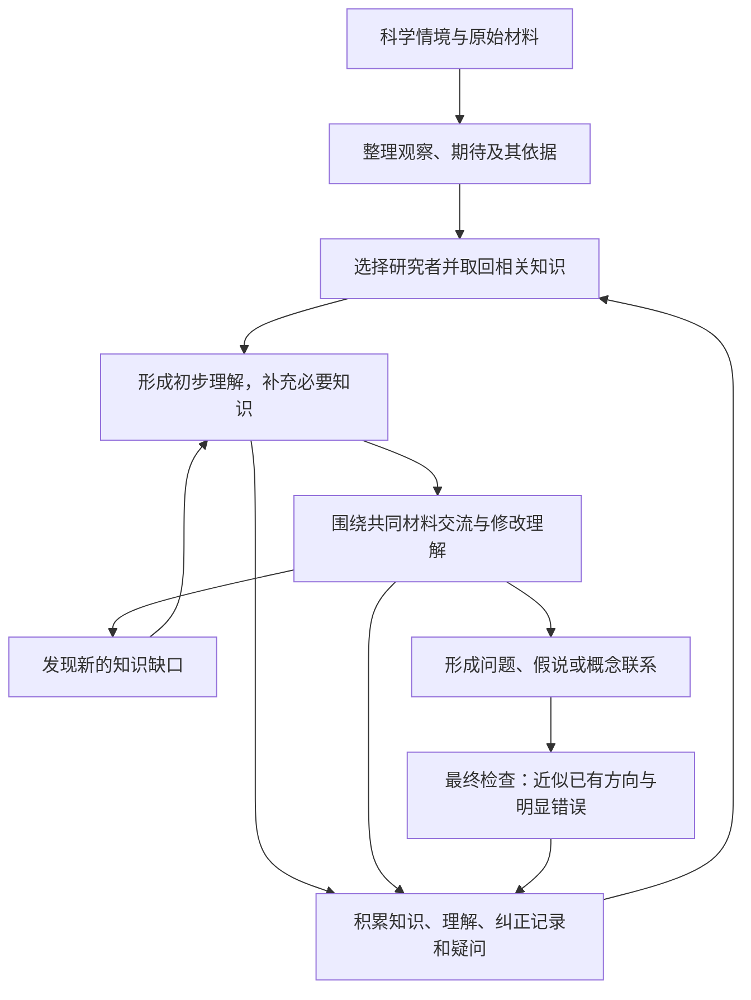

**持续学习与共同提问的 Agent 计划（讨论稿）**

日期：2026-11-04。状态：供用户审阅，确认后再实践。本次只整理计划。

**目标是让具有知识积累、能够持续学习的研究者，共同探索一个科学情境，并从交流中形成新的研究问题、假说或概念联系。** 每次研究既留下候选 idea，也留下参与者更新后的理解、疑问和经验，供后续研究继续使用。

起点可以来自一个领域，也可以包含多个领域的材料。研究过程中允许重新定义对象、改变问题、引入新的领域；最终研究问题由参与者共同形成。当前重点是把这种学习和交流过程做出来，论文评测与对照设计留到以后。

**整体过程包含两个相互连接的循环。** 一个是“理解材料—交流—发现知识缺口—继续学习—重新交流”，另一个是“取回已有知识—形成新理解—整理记忆—供下次研究使用”。下面表示这些关系，具体讨论不要求按固定轮次执行。



**先准备一个可以共同探索的科学情境。** 输入可以包括数据、现有理论、成功案例、异常现象、失败记录、新的观察或操作能力，以及尚未联系起来的知识片段。提供足以理解背景的材料，并把“最终值得问什么”留给讨论。

对涉及预期与观察差异的材料，增加一个明确的整理步骤：


| 内容             | 需要保留的信息                               |
| ---------------- | -------------------------------------------- |
| 观察到了什么     | 原始记录、现象描述、观察条件和获取方式       |
| 原来期待什么     | 某个理论、经验或模型对这些条件的预期         |
| 为什么有这个期待 | 理论前提、推导、成功案例或文献依据           |
| 差异目前怎样理解 | 已有解释、彼此冲突的解释，以及尚不知道的部分 |

“期待”可以有多个；没有明确预期时直接记录未知。原始材料与整理后的解释同时保留，参与者可以回看来源、质疑“异常”的判断，也可以补充材料。理论的成功范围同样有价值，它帮助研究者理解一个差异为什么值得注意。

**领域研究者需要有可积累的知识基础。** 根据科学情境初步判断相关领域，优先调用已有研究者；需要新的知识方向时，再扩展现有研究者的学习范围或加入新的参与者。领域选择可以随讨论变化。

每位研究者保留稳定的身份和知识记录，包括主要研究范围、已整理的概念与模型、可复用的推导和例子、薄弱环节、当前疑问及原始来源。专业差异来自实际读过的材料和形成的理解，而不只来自角色名称。

以量子物理研究者为例，其基础可以包括必要的线性代数与概率知识，以及量子态、测量、时间演化、叠加和纠缠等概念。具体学习范围依研究情境确定。这个例子说明如何建立知识基础，不预先把第一轮选题限定为量子物理。

学习可以利用模型已有知识作为起点，再结合可靠教材、综述、原始研究与具体例子补齐。针对不熟悉的概念，沿前置知识继续学习；已经形成可靠笔记的内容则直接取回，避免重复整理整门学科。

**学习要留下能够再次使用的理解。** 一次学习可以形成一份简短笔记，说明概念在解决什么困惑、主要关系怎样得到、适用条件是什么、一个具体例子，以及自己仍未理解的部分。必要时通过推导、小例子或简单计算检查理解。

阅读过一篇资料、能够复述摘要，与能够运用其中的概念，分别记录。对“已掌握”的判断尽量附上实际解释、推导或使用记录。这属于研究者自身的学习过程，不增加新 idea 的解题或实验验收要求。

学习由具体需要牵引。例如，已经掌握封闭量子系统演化的研究者，在遇到环境噪声问题后，可以进一步学习密度矩阵、开放系统和退相干。它带着新增理解回到讨论，这些内容也进入后续可复用的知识积累。

**持久化保存资料、理解和研究经历，并让它们在下一次任务中真正被取回。** 初期采用外部文件与索引即可，不要求修改模型权重，也不要求保持一个进程永久运行。


| 保存位置         | 保存什么                                                     | 如何使用                                         |
| ---------------- | ------------------------------------------------------------ | ------------------------------------------------ |
| 共享资料库       | 原始论文、教材片段、数据、图表、出处与版本                   | 所有参与者可以查看同一来源，避免只凭对方摘要交流 |
| 研究者的长期笔记 | 概念联系、模型、推导、适用条件、学习例子、纠正记录、未决问题 | 新任务开始时按情境取回相关内容，继续积累个人理解 |
| 本次共同研究记录 | 当前材料、共同图示、并列解释、分歧、问题变化和所有候选分支   | 支持讨论接续，也留下 idea 如何形成的过程         |

新任务开始时，先查看研究者的知识索引，取回相关笔记、疑问和纠正记录，再决定需要重读哪些原始资料。整个历史不必一次性装入上下文。

学习和讨论结束后，整理值得复用的内容：通用概念进入长期笔记；特定情境中的猜测保留为情境性假说；未解决的问题可以成为以后研究的入口。原始记录保留，压缩笔记能够追溯到来源。

记忆中区分来源知识、agent 的理解或推论、待研究假说，以及已有纠正。发现旧理解有误时，记录修订原因和新版本，取回时优先展示当前版本。多个研究者解释不同时，可以并列保留；共享资料不要求立即统一观点。跨任务复用还应记录来源任务，避免把旧任务中的答案或猜想误当成新任务的独立发现。

**交流围绕共同可见、可以修改的研究对象展开。** 共同对象可以是一组观察、一张图、一个简化模型、一段解释，或几个尚未接起来的概念。每位研究者先形成自己的初步理解，再把依据、困惑和可能的联系带入讨论。

值得允许的交流动作包括：

- 追问一个观察怎样得到，或一个期待依赖什么前提。
- 请对方澄清概念，检查相同词语是否指向不同对象。
- 提出类比，同时说明它在哪里相似、在哪里对不上。
- 修改共同图示或模型，区分原来混在一起的状态、关系或尺度。
- 因对方的追问而改写自己的问题，并向对方解释变化。
- 请求补充材料、承认知识缺口，带着具体疑问继续学习。

这些是可用的讨论动作，不固定成每轮必须填完的表格，也不预先限定谁出题、谁提供解法。交流应能影响参与者各自的问题表述，允许出现新的共同研究对象。

例如，研究者提出“这个系统为什么没有恢复”时，对方可以追问“恢复的是成员状态、相互作用，还是整体功能”。这个追问可能改变双方对材料的理解，并产生关于“恢复”本身的新问题。例子只说明交流方式，具体方向是否已有研究交由最终检查。

讨论中保留有依据的分歧，不要求每轮达成共识。协调工作主要负责组织材料、连接相关追问、安排补充学习和记录变化，避免提前替研究者确定唯一问题或答案。

**学习与讨论持续往返。** 研究者具有足以开始理解材料的基础后即可加入讨论。别人提出的问题可能暴露新的知识缺口，新增知识又可能改变讨论方向。每次补充学习尽量说明“现在缺什么、为什么需要、学到什么改变了原来的理解”。

一次讨论可以留下明确的候选，也可以留下需要继续学习的疑问。达到本轮约定的时间或调用预算时，保存当前状态，下一次从已有记录继续；不为结束一轮而强行形成完整理论。

**候选 idea 可以是问题、假说、新关系或新的问题表述。** 整理时说清它关心什么、怎样从材料和交流中出现，以及为什么值得继续追问。公式、完整解法、数据可得性和实验方案均为可选，所有初稿与修改分支保留。

最终 check agent 只有两项职责：

1. **方向查重。** 检索相关研究，比较核心问题和思路。方向非常相近就标为“已有”；不能只靠名称、应用细节或参数不同避开这一判断。仅共享宽泛关键词不足以判重。保存实际来源和相近之处；检索不足单独记录，“暂未找到”表示本次搜索结果。
2. **明显数学或逻辑错误检查。** 指出具体的算术、方程、量纲或逻辑矛盾。没有明显错误的概念性方向可以保留；未知效果、缺少证明和暂时不能验证，不构成这里的错误。

两项结果分别保存。已有方向仍可作为知识和研究经历留存，但不标为新的候选贡献。检查之后，研究者可以依据新找到的资料继续学习或修改想法，原始版本保持可追溯。

**第一轮实践按一个小型研究过程展开。** 待本计划审阅后，按下面的顺序逐步落地：

1. 选定一个具体科学情境，整理原始材料，以及其中的观察、期待和期待依据；先保留开放的研究问题。
2. 判断最初需要哪些知识，选择首批研究者，为其建立可复用的基础笔记和知识索引。参与者数量与领域由材料需要决定。
3. 让研究者带着各自理解交流，使用一份共同研究记录，允许补材料、重新定义对象和改变问题。
4. 在讨论需要时安排针对性学习，将新增理解带回交流，并同时整理长期记忆。
5. 保存形成的候选和过程，执行两项最终检查；暂时没有形成候选时，也保存疑问和继续学习的位置。
6. 下一次研究或接续讨论时取回相关积累，确认能够从已有理解继续，而不重新开始整套阅读。

这一轮先看清材料、学习和交流怎样共同推动问题形成，再决定哪些动作需要进一步固定成系统机制。

**实践前需要确定的事项保持少量。** 选什么科学情境、有哪些初始资料、首批研究者需要哪些知识基础，以及本轮学习、检索和讨论的预算。研究模型沿用现有约定的 GPT-6 Luna；具体记忆检索与存储工具在实践阶段选择，先保证来源可回看、理解可修订、研究可接续。

**与当前项目的衔接。** 现有 `1103_boundary_discovery` 已有角色调用、材料留存和最终检查的基础。此前核查到的实现主要保存单次运行状态与阶段产物；本计划需要补充跨任务研究者身份、知识取回、学习整理和记忆修订，以及能够往返的研究交流。实践时复用合适的运行能力，并为新流程保留独立记录。

本稿整理已讨论的方向，作为下一次实践前的审阅材料；尚未启动上述学习与交流流程。

## 我们的上一轮对话


**有直接关系。起始材料决定 agent 最初能看见什么，交流则决定它们后来把什么看成一个问题。** 所以，“给它们什么”和“让它们交流什么”，应该放在一起考虑。

而且，从一个领域的材料开始完全可以。关键是讨论过程中，参与者能否改变最初的问题、研究对象甚至研究目标。起点来自一个领域，不意味着最后只能给这个领域补一种解法。

**首先，初始输入可以比“数据集”丰富很多。**


| 可以提供的材料                 | 它可能引发的追问                               |
| ------------------------------ | ---------------------------------------------- |
| 原始观察，以及观察怎样获得     | 这个差异来自对象本身，还是观察方式？           |
| 现有理论、成功案例和适用条件   | 理论为什么在这里成立？哪些前提平时被默认了？   |
| 异常、失败、相互矛盾的结果     | 哪个概念、解释或测量方式需要重新理解？         |
| 不同领域中相似但解释不同的现象 | 为什么看起来相似，却被理解成不同的事情？       |
| 新仪器、新材料或新的操作能力   | 过去无法看见、无法操作的东西，现在可以问什么？ |
| 尚未联系起来的知识片段         | 两条分别成立的认识，放在一起会产生什么问题？   |

你举的经典物理与量子物理，体现的就是“理论及其适用边界”这类入口。更准确地说，经典近似是否适用不只由尺寸决定，还与具体物理条件和观察尺度有关。

这里一个重要细节是：**“异常”本身已经包含了解释。** 同一个观察，相对于一种理论是异常，相对于另一种理论可能很正常。因此，最好同时保留“观察到了什么”“原来期待什么”“为什么有这个期待”，让 agent 可以重新审视这个差异。

如果只给“这里的理论失效了”，我们已经替它决定了问题；如果保留原始材料，它也可能发现真正值得研究的是测量方式、对象定义，或者两个理论之间没有被注意到的联系。

**借鉴人类交流，我觉得值得抓住的是：人们会共同修改一份尚未完成的理解。**

这方面确实有相关研究。我这次核对了两项来源的摘要或书介：

* Nersessian 的 [Creating Scientific Concepts](https://doi.org/10.7551/mitpress/7967.001.0001) 讨论新概念怎样通过类比、图像表征、思想实验和模型构造逐步形成。这提示我们，交流可以围绕一张图、一种简化模型或一段尚未完整的解释展开。
* Star 和 Griesemer 的 [boundary objects 研究](https://doi.org/10.1177/030631289019003001) 研究不同群体怎样围绕共同对象合作，同时保留不同的理解。这提示我们，合作不必从“大家先统一概念”开始。

由此得到的设计启发是：**agent 之间可以交换“我目前怎样理解这份材料，以及哪些地方还没有想通”。** 对方有机会修改这份理解，而不只是评价一个已经成形的 idea。

例如，交流内容可以很自然：

> “我把这两个现象当成同一种情况，你为什么认为它们不同？”
>
> “你说的‘恢复’，具体是哪个量恢复了？”
>
> “这张图让我想起另一种现象，但它们在这个地方对不上。”
>
> “你的追问让我发现，我原先研究的对象可能定义错了。”
>
> “我们是不是一直在问一个太窄的问题？”

这里真正有生产力的部分，是**一个人的疑问改变了另一个人理解材料的方式，而这种改变又反过来影响前者。**

举一个纯粹用于说明交流方式的假想讨论：

> **甲的材料：** 某微生物群落在外部条件恢复后，群体功能仍未恢复。
>
> **乙的材料：** 某协作团队在错误信息被纠正后，集体判断仍未恢复。

甲说：“我原来以为外部条件恢复，系统就应该恢复，现在怀疑内部还留下了变化。”

乙说：“我的材料里，信息虽然纠正了，但成员以后听谁的，可能已经改变。你那里会不会也有成员之间关系的变化？”

甲回应：“微生物这里不能直接叫信任。但这提醒我，要把成员自身的状态与成员之间的相互作用分开。反过来，你所谓恢复，究竟是每个人知道了正确事实，还是整个团队恢复了协作？”

于是，双方可能共同提出：

> **经历扰动后，成员的恢复与关系的恢复能否分离？我们通常说的‘系统恢复’，究竟指什么？**

这个方向可能已有研究，这里只用于说明交流。值得关注的是：双方原来的提问都改变了，一个共同的研究对象逐渐出现。

**这也意味着，agent 的差异最好来自它们实际接触过的材料和形成的理解。** 仅仅分别告诉它们“你是物理学家”“你是生物学家”，未必能产生有内容的交流。它们需要各自带着具体事实、模型、经验和疑问，同时能够查看对方引用的原始材料。

共享的东西则可以是一张不断修改的图、一份现象记录，或者几种并列的解释。有人补充事实，有人重新画图，有人指出概念混用，有人保留异议。这样，讨论有共同对象，又不会过早把所有观点压成一个答案。

我现在倾向于：**最初给系统一个可以共同探索的科学情境，而把“最终值得问什么”留给讨论。** 材料里可以有数据、理论、异常、成功案例和零散线索；讨论允许补材料、换理解、重新定义对象。我们先观察一个具体问题如何在这种往返中长出来，再决定哪些交流动作值得做成系统机

**对，我赞成。你描述的是一个有知识积累、能够继续学习的研究者，而这种连续性应该成为系统的一部分。** 它面对新情境时，能够带着过去形成的理解进入讨论，再根据讨论暴露出的缺口继续深入学习。

我们已经确定的“观察到了什么、原来期待什么、为什么有这个期待”，也可以成为它整理新材料的一步。

**持久化是可以做到的，但要明确保存什么。** 初期可以通过外部知识与研究记忆实现，不需要先修改模型权重，也不需要让一个进程永远运行。下次调用时，恢复这个研究者的相关知识和研究状态即可。

我觉得至少应该积累三类内容：


| 保存的内容             | 具体包括什么                                                                     |
| ---------------------- | -------------------------------------------------------------------------------- |
| **领域知识基础**       | 概念、理论、数学工具、典型现象、适用条件，以及可回看的原始来源                   |
| **学习形成的理解**     | 自己整理的解释、推导、例子、概念之间的联系，以及曾经理解错并被纠正的地方         |
| **研究经历与未决问题** | 遇到过什么现象、为什么困惑、提出过哪些解释、讨论怎样改变了理解、还有什么没有弄懂 |

其中第二类尤其重要。只保存论文和摘要，下次仍可能需要重新理解；保存“这个概念为什么需要引入、怎样使用、什么情况下不能使用”，才更接近你说的知识积累。

当然，保存下来的自述也可能是错的。因此，来源中的知识、agent 自己的推论、尚未证实的假说，要能够分清；被纠正的理解也应留下修改记录。

**拿你的量子物理例子来说，我会这样理解它的学习过程。**

这个研究者应该有一个相对稳定的基础：必要的线性代数与概率知识，以及量子态、测量、时间演化、叠加和纠缠等概念。可以利用模型已有知识作为起点，再通过可靠教材、具体推导和例子补齐，而不必每次从头读完整门物理学。

当新的科学情境涉及“环境噪声怎样影响量子相干”时，它再判断自己缺什么：

> 我已有封闭系统演化的知识，但这里涉及环境相互作用，需要深入理解密度矩阵、开放系统和退相干。

这次学到的内容、理解过程和适用条件被保存。下次遇到相关情境，就可以直接调用这些积累，重点学习新的缺口。每次进入讨论，只取回相关部分；必要时再查看完整来源。

这里，“学到了”的一个实际含义是：**它能解释概念、在具体例子里使用它，并知道哪些地方仍然不会。** 阅读时做一点推导、解释例子或检查概念混淆，是学习本身的一部分，不需要把它变成论文评测，也不要求新提出的 idea 当场得到解决。

**还有一点我想补充：学习与交流应该交替发生。**

不必等每个 agent 都充分学完，才允许开始讨论。一个有基础的量子物理研究者可能听到另一个领域的描述后，才发现：

> “我原来把你的‘记忆’理解成状态保存，但你说的是历史改变未来响应。这里涉及的物理问题可能需要重新梳理。”

于是，它带着这个新疑问回去学习；学到的东西又可能反过来改变双方的问题。这样的循环才把持久知识积累和我们关心的“问题共同形成”接起来：

**已有理解 → 讨论暴露缺口 → 针对性学习 → 修改理解 → 再次讨论。**

不同 agent 可以共享原始资料，但各自保留学习笔记、解释和疑问。交流后也不必立刻合并成一个统一观点。这样，它们既能检查对方的依据，也能保留真正有内容的认识差异。

我也核对了当前实现：系统已经会保存运行文件和同一次研究的证据链，但还没有自动跨任务积累、取回和修订某位领域研究者知识的机制。当前运行器 (1103\_boundary\_discovery/src/runtime.py:171)

你提出的这一层很明确：**让每次研究不仅留下几个 idea，也让参与者带着更新后的知识、疑问和理解进入下一次研究。** 当前还停留在这个概念设计阶段，没有启动实现。

```
  Worked for 5m 58s • 18:29
目标是让多领域 agent 通过共同探索形成新问题，而非套用外域方法；论文对照暂已搁置。已明确起始材料应保留观察、预期及其依据，并提出让领域 agent 持久积累知识、针对新问题学习，与交流交替推进。现有系统能保存运行文件及单次研究证据，但跨任务知识积累、取回和修订仍属概念设计，尚未实现或验证。
```
