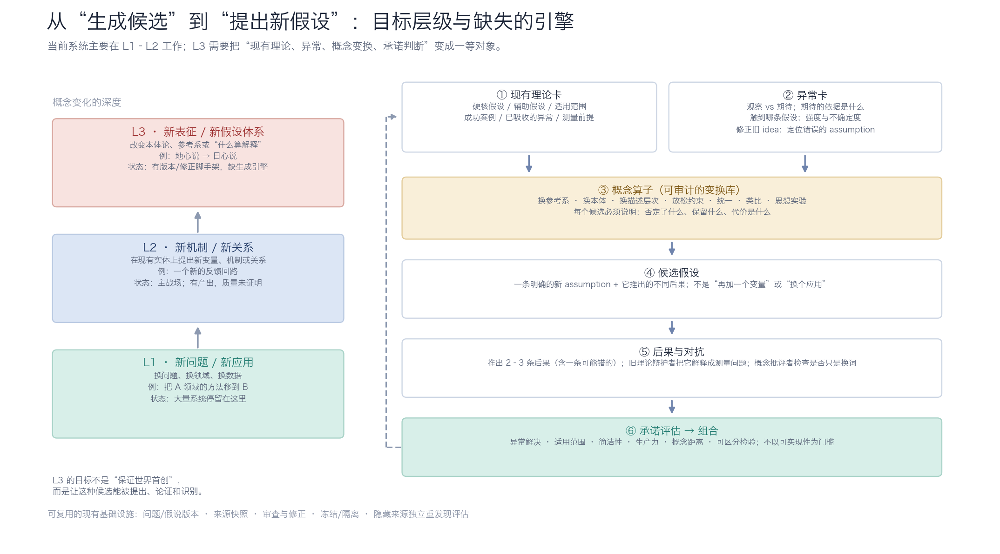

这个目标清楚，而且它把系统从“idea 生成器”推到了“概念变化引擎”。两者不是程度差别，是对象差别：新 idea 可以是新问题、新应用、新组合；新 assumption 要动到现有理论的硬核。

## 一、先把“新”分三层

- **L1 新问题 / 新应用**：换问题、换领域、换数据。大多数 agent 系统停在这里。
- **L2 新机制 / 新关系**：在现有实体上提出新变量、机制、关系。当前系统的主战场。
- **L3 新表征 / 新假设体系**：换本体论、换参考系、换“什么算解释”。地心说 → 日心说是 L3。

判断一个输出是 L2 还是 L3，看五件事：

1. 它否定或替换了一条**硬核假设**，而不是加一条辅助假设；
2. 它能解释旧理论只能靠“补丁”吸收的**异常**；
3. 它推出至少一条与旧理论不同的**可检验后果**；
4. 它带来一个新的**研究纲领**：辅助假设、新问题、新方法，而不是一句反直觉的话；
5. 它原则上可被否证，但不要求现在能实现、能证明、有数据。

你说的“promising”也应该按这个标准定义：不是“容易做”，而是**异常解决、适用范围、简洁性、生产力、概念距离、可区分后果**。这一点系统其实已经部分做对了——它明确不以可实现性为门槛。

粗略定位一下现在的 agent 系统：

| 类型                                                      | 主要在优化                     | 本体论              | 成功标准                          |
| --------------------------------------------------------- | ------------------------------ | ------------------- | --------------------------------- |
| AI Scientist / ResearchAgent / Virtual Lab / EvoScientist | 研究工作流、实验闭环、假设排序 | 基本固定            | 可发表增量、实验跑通              |
| 当前这套系统                                              | 认识论状态、可审计的概念动作   | 由材料和 brief 给定 | 候选 + 查重 + 数学粗筛            |
| 你想要的 L3                                               | 概念变化本身                   | 可被改写            | 新 assumption + 异常解释 + 新后果 |

有 debate/tournament 的系统不少，但多数是在**同一本体论内**给假设排序。真正难的是让系统有权、也有能力去改写本体论本身。

## 二、当前系统已经做对了什么

这部分值得肯定，而且很多系统没有：

- **不以可实现性为门槛**：rankers 和协议都明确说，不要求证明、数据、实现、实验可行性。
- **假说卡不是摘要**：有 `assumption / motivation / conceptual_move / implications / open_questions / depends_on`，已经在逼近“假设 + 后果”的结构。
- **版本 + 依赖**：`dependency_obligations` 会在前提变化时标出下游分支，要求作者 revise / reaffirm / park。这是“理论修复”的骨架。
- **分支保留**：不删除、不强制共识，允许多个研究纲领并存。
- **隐藏来源 + 独立重发现**：`evaluation_context` 这套机制，天生适合评估“能不能在不看答案的情况下重新提出一个已知的概念变化”。这是很稀缺的基础设施。
- **冻结与隔离**：生成和评价分开，终审不能回写。

所以它不是从零开始。它已经是一个相当强的**科研认识论基础设施**。缺的是上面的“概念引擎”。

## 三、但生成引擎不是为 L3 设计的

五个结构缺口，都是代码/协议层面能指出来的：

**1. 没有“现有理论”这个对象。**
现在材料里是 `observation / expectation / existing_explanations / unknowns` 的自由文本，假说卡是每个研究者自己的分支。没有一张共享的 **TheoryCard** 写清楚：硬核假设是什么、哪些是辅助假设、适用范围、已经吸收了哪些异常、测量前提是什么。没有硬核，系统就无法区分“改硬核”和“加一个本轮均轮”。

**2. 没有“异常”这个对象。**
异常混在材料里，没有结构化的“这个观察与哪条假设冲突、冲突强度多大、有没有可能是测量错误”。而概念变化通常不是从“未知”开始的，是从“旧理论解释不了、又不想再加补丁”的异常开始的。

**3. 没有概念算子库。**
协议要求“提出一个 conceptual move”，但把“怎么变”完全留给模型自由发挥。自由发挥很容易回到 L2：加一个变量、换一个应用、找一个类比。L3 需要一套可审计的变换，例如：换参考系、换本体、换描述层次、放松约束、统一两个领域、类比迁移、思想实验、改变解释目标。每个候选要说明：**否定了什么、保留什么、代价是什么**。

**4. 没有旧理论的辩护者。**
内部审查员只查算术、逻辑、归因错误，不负责“这条新假设真的比旧理论好吗”。没有 incumbent defender 把异常解释成测量问题、把新假设逼到必须加辅助假设，新 assumption 就很容易停留在“听起来很新”的层面。范式转换需要对手。

**5. “promising”没有显式判据。**
终审是**否定式**的：是否已有相近工作、是否有明显数学错误。它能防止虚假新颖，但不能识别“这是一个进步的研究纲领”。Rankers 说“评估潜在智识贡献”，但判据是隐式的，容易奖励表达完整、熟悉的方向。需要把异常解决、 scope、简洁性、生产力、概念距离、可区分检验显式列出来。

另外两个较小的但真实的点：

- 迭代太浅。一次生成 + 一个发展期（默认 2 轮），而 L3 需要多轮“猜想 → 后果 → 反例 → 修正”。
- 当前 brief 是主题式的（“微生物群落恢复”“葡萄酒数据”），不是危机式的（“现有理论 + 它解释不了的观察 + 测量限制”）。协议允许改写问题，但输入已经决定了可见宇宙。L3 的 brief 应该给一个**危机情境**，不是给一个研究主题。

## 四、缺的不是更多 agent，是“概念引擎”

图右侧是我认为需要补的六件事，按依赖顺序：

1. **TheoryCard**：硬核 / 辅助 / 范围 / 成功案例 / 已吸收异常 / 测量前提。
2. **AnomalyCard**：观察 vs 期待、期待依据、触到哪条假设、强度与不确定度。
3. **概念算子**：一套可审计的变换库，每个候选必须说明否定什么、保留什么、代价是什么。
4. **候选假设**：一条明确的新 assumption + 它推出的不同后果。不是“再加一个变量”。
5. **后果与对抗**：推出 2–3 条后果（含一条可能错的）；旧理论辩护者把它解释成测量问题；概念批评者检查是否只是换词。
6. **承诺评估 → 组合**：异常解决、范围、简洁性、生产力、概念距离、可区分检验；不以可实现性为门槛。

拿地心说 → 日心说走一遍：

- **TheoryCard**：地球静止（硬核）、天体匀速圆周（硬核/辅助）、本轮均轮（保护带）、观测范围。
- **AnomalyCard**：行星逆行（旧理论已经用本轮吸收了，说明它的补丁能力）、金星相位（旧结构很难吸收）、恒星视差缺失（注意：这是**日心说的成本**，不是地心说的胜利）。
- **算子**：换参考系 + 实体重认（地球是行星）。
- **候选**：地球自转 + 公转。后果：逆行被解释、金星相位、视差（需要假设恒星极远）、相对大小。
- **辩护者**：“没有视差，说明地球不动。” 候选必须加一条辅助假设：恒星距离极远。这不是一句口号，而是一个研究纲领。
- **承诺评估**：用更少的本轮解释更多现象；预测视差；带来新物理；概念距离极大；同时有一条明确的成本。

这就是为什么“提出一个新 assumption”不能只输出一句话。日心说之所以成立，不只是“太阳在中心”，而是它带了一套新的辅助假设和新的物理。系统要能提出的是**assumption + 保护带 + 后果 + 成本**这个整体。

## 五、怎么评价它真的能提出新假设

这是这套系统最有机会做出差异的地方，因为它已经有隐藏来源的机制。

**1. 历史盲重发现。**
给系统“变动前的材料 + 当时的旧理论 + 异常”，隐藏后来的答案，看它能不能提出那个概念变化。比如：大陆漂移、板块构造、幽门螺杆菌、朊病毒、传染病的病菌说。不要一上来用哥白尼——模型见过太多次，测到的是记忆不是推理。选不太出名、但概念变化清晰的案例，或者做合成理论修复任务。

**2. 理论修复。**
给一个已知错误的 assumption，看它是**换掉前提**，还是**加补丁**。这可以直接复用现有的 `dependency_obligations`：前提改了，下游分支被标出来，作者必须 revise / reaffirm / park。这比“从零生成”更容易做出第一个可验证结果。

**3. 指标。**

- 它有没有识别出硬核假设？
- 它提的是核心变化，还是辅助补丁？
- 它有没有推出输入里没有的后果？
- 它有没有给出可区分检验？
- 它有没有产生一个研究纲领（辅助假设、新问题），而不是一句口号？
- “本轮/补丁比例”：新假设是减少辅助假设，还是增加？

**4. 专家评审。**
历史学家/科学哲学家评“概念动作”，不评“可不可行”。自动指标只做过滤。

**5. 不要用“世界首创”当指标。**
系统能给的是**任务相对的新**；领域相对的新要靠查重；世界首创无法由这套系统证明。隐藏来源测试测的是“能不能重新推导出这个概念变化”，这本身已经很有信息量。

## 六、现实预期

- LLM 学过科学史，它可能**复现**已知的概念变化，而不是**发明**新的。隐藏来源测试能区分“推理出来”和“背出来”。
- 一次运行不会产生范式转换。现实的产出单位是**候选研究纲领**：一条新 assumption + 保护带 + 可区分后果 + 开放问题。
- 大多数 L3 候选会是错的。系统应该输出一个有明确理由的**组合**，而不是一个判决。
- 当前的保守性（审查、查重、数学粗筛）对完整性是好事，但会压制大胆的 move。要把“错误”和“不熟悉”分开：前者要修，后者不该自动扣分。

## 七、如果只做一件事

我建议的顺序是：

1. **先做 TheoryCard + AnomalyCard**，因为如果没有“旧理论”和“异常”的表示，算子、辩护者、承诺评估都没有作用对象。
2. **加一个 incumbent defender**，让新假设必须经过“旧理论最强版本”的反驳。
3. **选一个历史盲案例做评估**，不要先改整个 pipeline。

最小可行的一步甚至可以不碰历史案例：从现有 run 里挑一个被 parked 或未被支持的假说，做一次“前提修复”——找出哪条 assumption 错了、替换它、推出新后果、让旧分支的辩护者反驳。这复用现有的依赖图和状态层，成本最低。

---

所以我的判断是：**这套系统现在是一个很好的“科研认识论基础设施”，但还不是“概念发现引擎”。差距不在模型大小或工具数量，而在表示层——没有把现有理论、异常、概念变换、承诺判断变成一等对象。** 补上这层，它才有机会从 L2 走到 L3；不补，它会继续产出很规范、很可审计的 L2 idea。

你更想先做哪一半：**A. 从异常提出新假设**（更难，需要 TheoryCard / AnomalyCard），还是 **B. 修正旧假设**（更快，能复用现有的依赖图）？我可以按你选的方向，先把输入结构和角色协议设计出来，仍然不改代码。
